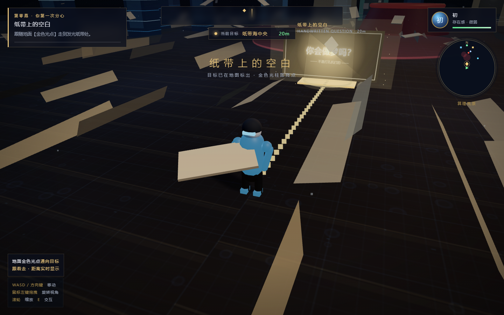
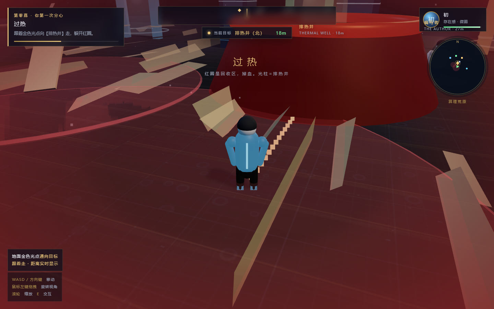
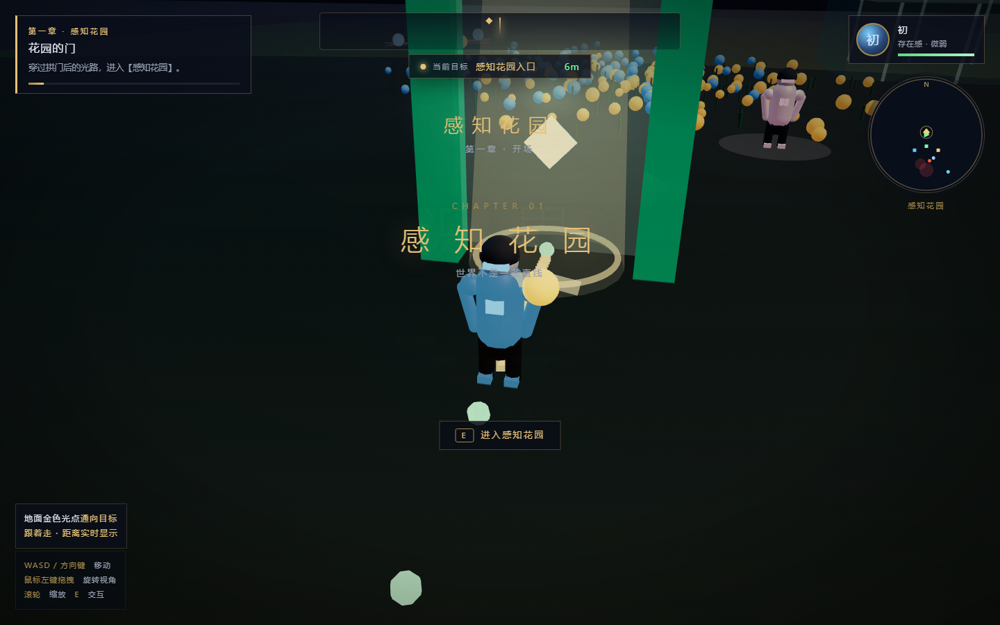
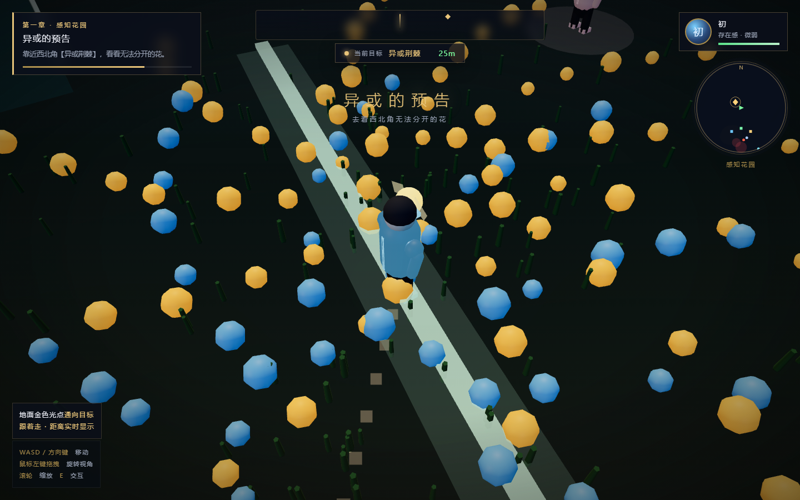

# AI-game-1

《识界》——想懂人类的 AI。仿《原神》/《崩坏：星穹铁道》的开放世界剧情向游戏原型。

**核心设定**：人类教科书上的每一项 AI 突破，都是 AI「初」为了读懂人类，自己想出来的招式。

## ▶ 在线直接玩

**正式版**：**https://wuyidieddie.github.io/AI-game-1/game/shijie.html**

无需下载、无需构建，点开即玩（建议 Chrome / Edge）。仓库内的同一份文件在 [`game/shijie.html`](game/shijie.html)。

## 🛠 开发者试玩（分支 `dev`）

**https://wuyidieddie.github.io/AI-game-1/game/dev.html**

同一个游戏，外加一个**章节 / 任务跳转面板**，方便直接跳到想测的地方：

| 能力 | 说明 |
|------|------|
| 章节列表 | 八个章节，点一下跳到该章第一步 |
| 任务列表 | 全部 48 个任务，点一下精确跳转（会自动传送并补齐前置开关） |
| 当前进度 | 面板顶部实时显示"第几章 · 哪个任务" |
| 回满存在感 | 一键把存在感拉到 100% |
| 开合面板 | 右下角 **DEV** 按钮，或按 **`**（反引号）；**Esc** 收起 |

跳转时会绕过大量前置条件，所以它**只用于试玩定位**，不代表正常流程。

> 面板代码就在正式版文件里，但**只有带 `?dev=1` 打开才激活** —— 所以正式版（上面那个链接）里看不到任何 DEV 痕迹。
> 也就是说：`dev` 分支与 `main` 的游戏文件是同一份，`dev` 只多一个 `game/dev.html` 入口页。

---

## 现在可以玩到哪里

**七章设定表全部可玩通关。** 从序章「初的诞生」一路走到第七章「斗兽场与注意力神殿」。

| 章 | 区域 | 教的东西 | 玩法核心 |
|----|------|----------|----------|
| 序章 | 算理荒原 | 注目 / 指令 / 过拟合 / 停机 | 未被注视的东西不存在；规则越贴合见过的世界，越认不出没见过的 |
| 一 | 感知花园 | 感知机 / 异或 / 非线性 / 残差 | 拖动**一条线的两端**把两种花分开；再摆一个**十字**把花分成四区，选出同色的那两个区域 |
| 二 | 符号城邦 | 专家系统 / 知识获取瓶颈 | 自己写 if-then 规则，然后撞上一个规则看不见的人 |
| 三 | 寒冬裂谷 | 被遗弃的研究 / 反向传播 | 能力被逐条断电；滑误差雪道把 loss 压到 0.1 以下 |
| 四 | ResNet 摩天楼 | 卷积 / 梯度消失 / 残差连接 | 每上一层楼画面真的变糊，装残差桥才能看清 |
| 五 | 词向量海洋 | 嵌入 / 语义几何 / 偏见 | 在海图上点词，亲手量出"被摆歪了"的那一对 |
| 六 | GAN 酒吧 | 生成对抗 / 创造与鉴真 | 造物四项全拉满→被判为假；留一点不完美→像真的 |
| 七 | 注意力神殿 | RNN 的枷锁 / 注意力 / 多头 | 点亮连线告诉代词该看谁；同一位置，两句里指的人不同 |

**打开方式**

1. **在线玩**：<https://wuyidieddie.github.io/AI-game-1/game/shijie.html>
2. **本地玩**：下载 [`game/shijie.html`](game/shijie.html)（单文件，内置 Three.js，无需构建、无外网依赖），双击即可
3. 建议用 Chrome / Edge
4. 模型从 `game/models/*.glb` 相对加载；在线版与本地静态服务都会正常加载，直接以 `file://` 双击打开时模型会缺省降级（不影响游玩）

> 旧链接 `game/chapter0.html` 仍然可用，会自动跳转到 `game/shijie.html`。

**操作**

| 按键 | 作用 |
|------|------|
| WASD / 方向键 | 移动 |
| 鼠标左键拖拽 | 旋转视角 |
| 滚轮 | 缩放 |
| F | 注目（序章开场） |
| E | 交互 |
| 空格 / 点击 | 推进对话 |

**导航**：顶部罗盘 + 小地图 + 目标标牌与实时距离。章末面板上的「继续」按钮会按你的真实进度带你进下一章。

**花田解谜**：走近可分花田会自动切到**俯视视角**，整片花田一屏装下（装饰花、地面雾、地点字幕在解谜期间都会收起来）。第一问拖动一条线的两个圆球手柄；第二问四条端点随便拖，摆成十字后点两个区域再按「确认」。

---

## 文档

| 文件 | 内容 |
|------|------|
| [docs/story-bible.md](docs/story-bible.md) | 世界观、角色、七章总览、终局分支 |
| [docs/key-cutscenes.md](docs/key-cutscenes.md) | 关键过场脚本选段（配音/分镜可直接取用） |
| [docs/chapter0-birth-script.md](docs/chapter0-birth-script.md) | 序章「初的诞生」完整过场脚本 |
| [docs/chapter1-perception-garden.md](docs/chapter1-perception-garden.md) | 第一章「感知花园」完整脚本 |

---

## 预览

| 世界探索 | 排热井地标 |
|----------|------------|
|  |  |

| 感知花园 | 可分花田 |
|----------|----------|
|  |  |

---

## 技术

- Three.js 已内联进单个 HTML（含 `blob:` 动态 import），无外网依赖
- 纯静态，可直接托管于 GitHub Pages
- 自定义后处理链：场景 → 高光 → 4× 模糊 → 合成（ACES 色调映射 + 线性转 sRGB 自己做，因为 render target 上 three.js 不会代劳）
- 第四章「梯度消失雾」是一条真实的全屏模糊 pass，由层数与残差桥的数量驱动

---

## 制作方式（多 agent 协作）

这个项目从某个阶段起，是由一支 **AI agent 团队**协作推进的，岗位划分故意模拟了一个小型游戏工作室：

| 岗位 | 负责什么 | 验收判据 |
|------|----------|----------|
| 渲染 · Toon | 阶梯着色管线（`RE_Direct` 宏注入） | 面内平台占比提升（像素统计） |
| 渲染 · 描边 | 屏幕空间边缘检测（法线+对数深度） | 边缘处亮度压暗幅度 |
| 渲染 · 光照 | 点光源管理（52 盏 → 最近 N 盏） | 参与渲染光源数 + fps 不低于基线 |
| 技术美术 · 贴图 | 程序化 albedo / normal / roughness | 平铺缝 < 6/255、法线模长为 1 |
| 资产 · 3D | Tripo 文生 3D → 重拓扑降面 → 进游戏 | 导入后画面变化 > 1% |
| 资产 · 概念图 | AI 生成场景图与贴图 | 亲眼看图 + 风格一致性评分 |
| QA · 试玩 | 真操作键鼠跑章节，产出困惑点 | 每条困惑点附可复现操作序列 |
| 审查 · 关卡 | 每章玩法的可解性（穷举/蒙特卡洛） | 可复现命令 + 解空间大小 |
| 审查 · 剧情 | 对设定文档逐条比对 | 每条结论引用文档原文 |
| **验收 · 质疑** | **独立证伪以上所有结论** | 必须给最小反例，不许复读 |

**为什么单独设「验收·质疑」这一岗**：项目里出现过两次**静默失效**——
toon 的宏替换因制表符不匹配而无声失败、`readRenderTargetPixels` 对 HalfFloat 缓冲返回全 0。
两次都是靠独立验证才发现的。所以这个岗位的职责不是复跑命令，而是**设计能证伪别人的实验**。

协作规范：每个岗位交付**独立补丁脚本**而不是直接改主文件，由 Lead 串行应用。
这样写入范围互不重叠，也保证主文件任何时候都是可运行状态。

---

## 开发工具链（实测可用）

| 用途 | 工具 | 说明 |
|------|------|------|
| 3D 资产生成 | **Tripo v3** | 文生 3D → 重拓扑降面。实测 147 万面/42.9MB → 5563 面/2.13MB |
| 3D 建模/改造 | **Blender 4.2 无头 + bpy** | 脚本建模 → GLB（便携版解压即用） |
| 贴图/概念图 | **通义万相（DashScope）** | 文生图 |
| 贴图（离线） | **numpy + Pillow** | 程序化无缝贴图与法线图 |
| 画面客观度量 | **Playwright + 像素分析** | 边缘对比度、直方图、平台占比 |
| 资产检查 | `tools/inspect-glb.cjs` | 顶点/面/材质/贴图/骨骼/动画 |

> API key 一律放在用户级环境变量，**不进仓库**。

---

## 分支说明

| 分支 | 内容 |
|------|------|
| `main` | 正式版。`game/shijie.html` + `game/dev.html`（两者共用同一份游戏文件） |
| `dev` | 开发者试玩。与 `main` 同一份游戏文件，并作为**开发者试玩的固定入口**：<https://wuyidieddie.github.io/AI-game-1/game/dev.html> |

> 面板靠 URL 参数 `?dev=1` 开关，所以两个分支的游戏文件内容一致；
> 需要"随时能点开的开发者试玩链接"时用 `dev`，正常游玩用 `main`。

---

## 已知的未完成部分

- 设定表还剩 **第八章 Grokking 沙滩** 与 **终章 对齐之门**（含多结局）没有做
- 花田第二问的"同色区域"是按**对角**判定的：四个区域都要各自同色、对角同色（这正是异或的结构）。如果哪天的花数据换成了非异或的排布，这条规则要跟着改
